# cartoon-short-skill

<p align="center">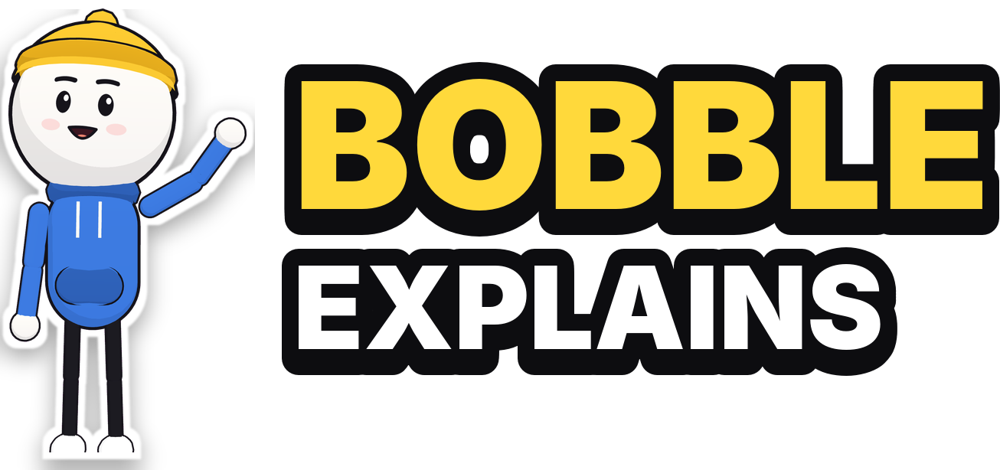</p>

A Claude skill that makes **Bobble Explains**: it turns a topic into a finished vertical (1080×1920) animated Short (20–90 s) starring
**Bobble** (yellow beanie, blue hoodie). You get a toon-shaded 3D world,
Bobble with a fully expressive face, a narrator voice, procedural music and SFX, and word-by-word captions. It's all
rendered in code with **Three.js + headless Chromium + ffmpeg**: no Remotion and no AI video generation.

<p align="center">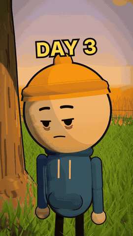</p>

Example output: *"What if you stopped sleeping?"* (27 s). The full episode is in `cartoon-shorts/examples/stopped-sleeping/`.

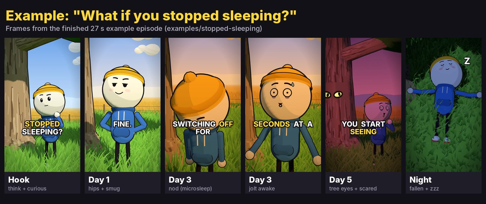

Second example: *"What if you drank only coffee for a week?"* (41 s, `cartoon-shorts/examples/coffee-week/`). It shows off
locations and props: it moves from the kitchen to the office, bedroom, street and finally the hospital, with a mug that
follows the hand and a cup pyramid that builds as the narration says "twelve cups a day".

<p align="center">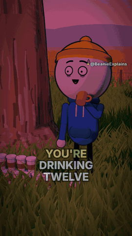</p>

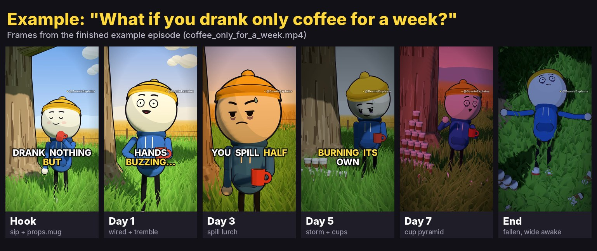

Third example: *"What if you never went to the doctor?"* (47 s, `cartoon-shorts/examples/doctor/`). It shows off the cast:
Mom and Dr. Patel each speak in their own voice with lip sync and a name tag, alongside a nurse, a boss, a coworker and a
street crowd.

<p align="center">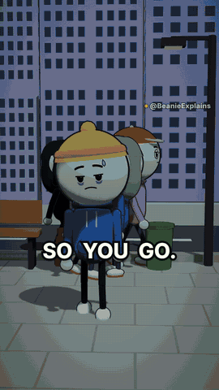</p>

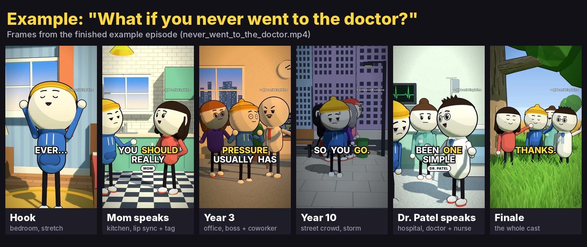

## What you can make it do

**Shorts or full videos.** `"format": "short"` renders vertical 1080×1920 Shorts/TikToks/Reels up to 90 s;
`"format": "video"` renders landscape 1920×1080 YouTube videos of 3–5 minutes with chapters. `scripts/thumbnail.py`
makes 1280×720 thumbnails from a clean frame, and `scripts/captions.py` writes caption files (and chapters).

**A whole cast.** Bobble can share the screen with anyone the story needs: doctors, bosses, kids, crowds. Each
person is one line of looks (hair, hats, glasses, lab coat, tie, height), and characters can speak their own lines in
their own voice, with lip sync and a name tag:

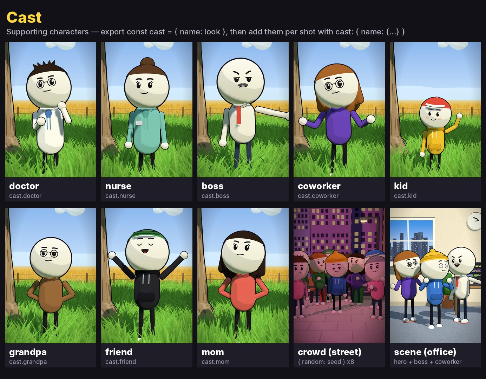

**8 locations.** Each shot picks where it happens, and the time of day changes the light, the windows and the lamps:

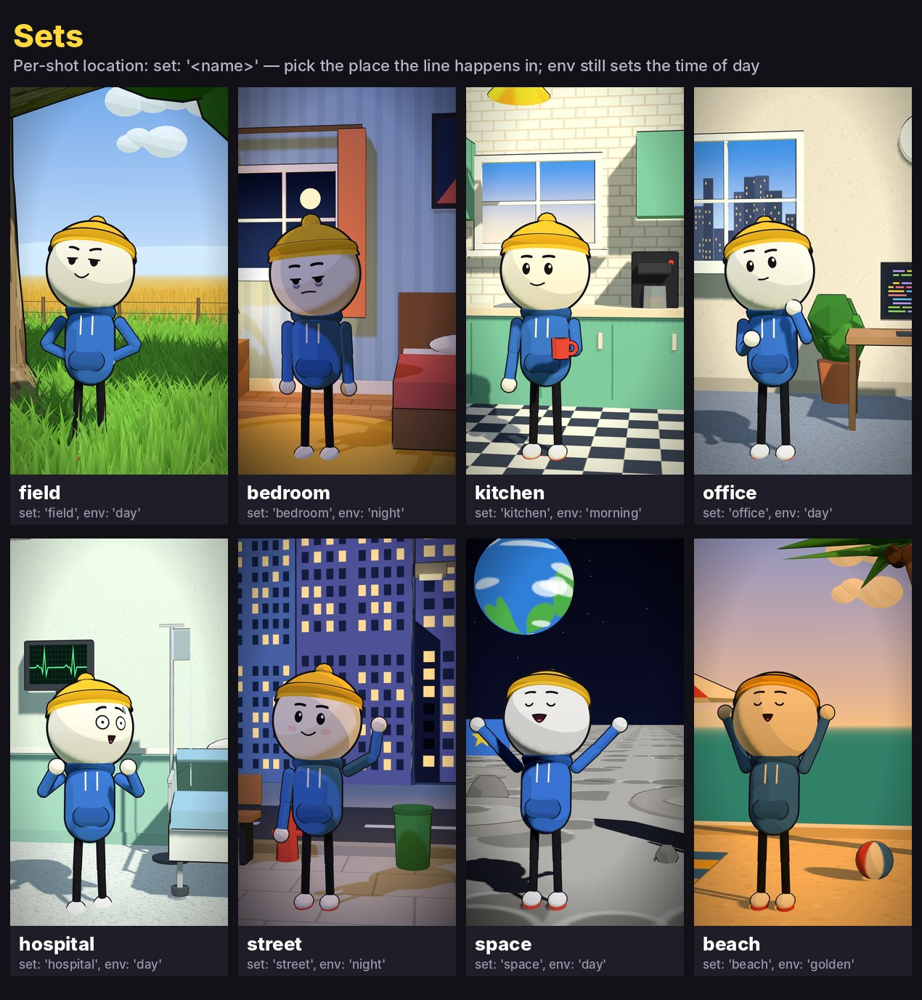

**19 built-in poses.** Blend between them with keyframes, or override any joint:

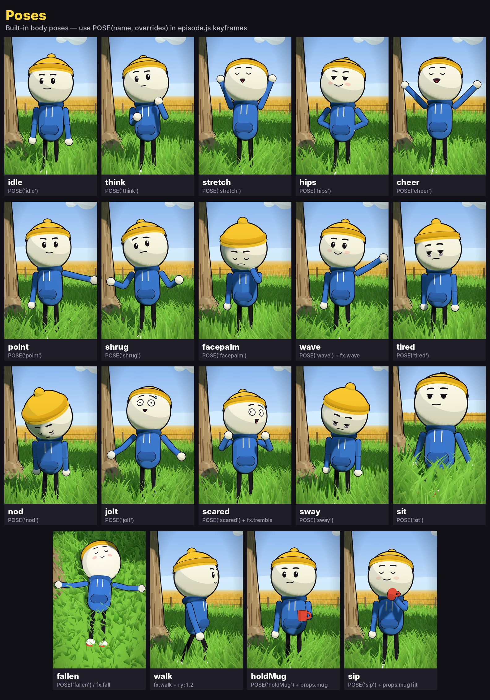

**Expressions.** The face is redrawn every frame from a few numbers, so it can morph smoothly between any of these:

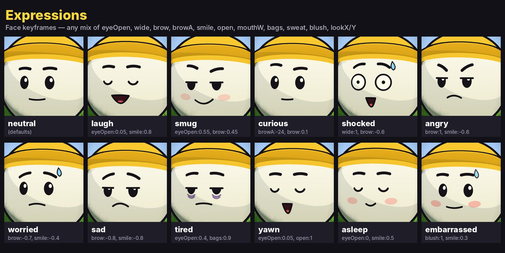

**Outfits.** Bobble is the Classic look. Other presets are for side characters or other series, one line of colours each (presets in `docs/images/outfits.json`):


**Lighting per shot.** Switching the look between shots shows time passing:

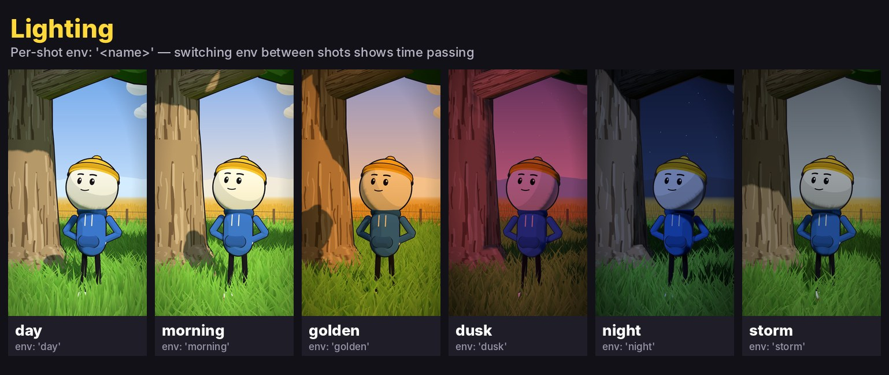

These sheets are rendered by the engine itself: `python3 docs/gallery/build_gallery.py [sleep.mp4] [coffee.mp4] [doctor.mp4]`
regenerates them, and the episode frames and GIF come from the optional MP4.

**Branding.** Add a `brand` block to `script.json` for a channel watermark and an end card, built from the
character's own face. Leave it out for an unbranded video.

<p align="center">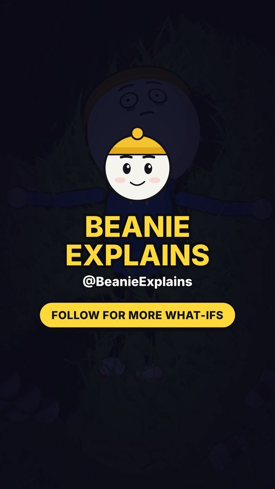</p>

## Publish straight to YouTube (optional)

`youtube-mcp/` is an MCP server for your own channel: upload Shorts, schedule them, edit metadata, manage playlists,
reply to comments, read analytics and set the banner, all from Claude. The skill's publishing playbook
([`references/youtube.md`](cartoon-shorts/references/youtube.md)) covers search-first titles, descriptions and tags,
captions, chapters, translations into 10 languages, thumbnails and the made-for-kids question, and works with any
YouTube connector. It runs locally with your own Google OAuth
client; setup takes about 10 minutes and is in [`youtube-mcp/README.md`](youtube-mcp/README.md).

## Install

Copy the `cartoon-shorts/` folder into a skills directory, e.g. `~/.claude/skills/cartoon-shorts/`, or into a
project's `.claude/skills/`. Then ask Claude for something like *"make a what-if short about drinking only coffee for a week"*.

Requirements on the machine that renders: Node 18+, `ffmpeg`, Python 3 with `numpy`, and Playwright with Chromium
(`npm i playwright && npx playwright install chromium`, or set `CHROMIUM_PATH`).

**Bring your own text-to-speech.** The pipeline only needs one audio file per script line, so any TTS works: a connected
connector (Cartesia, ElevenLabs, …), a cloud API (ElevenLabs, OpenAI, Deepgram, Azure, Google, Amazon Polly) through
`scripts/voice_lines.py`, a free local model (Piper is bundled, Kokoro or anything else via a command template), or your
own recordings. Claude asks which one you use and remembers it per project. See `cartoon-shorts/references/voices.md`.

## Manual use

```bash
S=cartoon-shorts
$S/scripts/new_project.sh ~/my-short           # engine + example episode
# write ~/my-short/script.json, then one audio file per line in ~/my-short/vo_raw/0.wav, 1.wav, ... from any TTS:
#   python3 $S/scripts/voice_lines.py ~/my-short --provider openai --voice ash     (key from $OPENAI_API_KEY)
#   $S/scripts/tts_piper.sh ~/my-short                                             (free, offline)
$S/scripts/prep_voice.sh ~/my-short
(cd ~/my-short && python3 audio.py)            # timeline.json + audio.wav
# write ~/my-short/episode.js (see cartoon-shorts/references/episode-api.md)
$S/scripts/stills.sh ~/my-short 1 5 10 15      # preview contact sheet
$S/scripts/render_all.sh ~/my-short final.mp4  # full render
```

## Layout

```
cartoon-shorts/
  SKILL.md                     workflow Claude follows
  LICENSE                      MIT (copy shipped with the skill)
  engine/scene.html            Three.js renderer: character rig, procedural face, field set, lighting, captions, branding
  engine/sets.js               the other locations: bedroom, kitchen, office, hospital, street, space, beach
  engine/render.mjs            headless Chromium frame capture -> ffmpeg
  engine/audio.py              word timings + procedural music/SFX mix
  scripts/                     new_project, voice_lines (any TTS), tts_piper, prep_voice, stills, render_all,
                               captions (SRT + chapters), thumbnail
  references/episode-api.md    poses, face params, environments, cameras
  references/youtube.md        publishing playbook: SEO, captions, translations, thumbnails
  references/voices.md         choosing a TTS: connectors, cloud APIs, local models, recordings
  examples/stopped-sleeping/   complete example episode
  examples/coffee-week/        second example: props (mug, cup pyramid) + SFX cues
  examples/doctor/             third example: supporting cast, crowd, lip-synced dialogue
  references/*.jpg             set / pose / expression / outfit / lighting sheets (for Claude to look at)
youtube-mcp/                   MCP server for your YouTube channel (uploads, metadata, comments, analytics)
docs/
  brand/                       Bobble Explains icons, wordmark, banner (and the scripts that make them)
  images/                      README gallery
  gallery/build_gallery.py     regenerates the gallery from the engine
```

## Credits

Created by **Sai Akash Neela** ([@SaiAkashNeela](https://github.com/SaiAkashNeela), [saiakashneela.com](https://www.saiakashneela.com)).
Bobble, the *Bobble Explains* name and the brand kit in `docs/brand/` belong to the author. You're welcome to use the engine, and the Bobble design under
the MIT licence, but please brand your own channel with your own name and handle.

Contributions are welcome: open an issue or a pull request. New poses, props, sets and environments are especially welcome.
Run `python3 docs/gallery/build_gallery.py` after engine changes so the README sheets stay accurate.

## License

[MIT](LICENSE) © 2026 Sai Akash Neela.

### Third-party software and content

Nothing third-party is vendored in this repository; these are fetched or used at run time under their own licences:

| Component | Licence | How it's used |
|---|---|---|
| [three.js](https://github.com/mrdoob/three.js) | MIT | npm dependency of the render project |
| [Playwright](https://github.com/microsoft/playwright) / Chromium | Apache-2.0 / BSD-style | headless frame capture |
| [FFmpeg](https://ffmpeg.org) | LGPL/GPL (depends on your build) | encoding, run as an external program |
| [Inter](https://github.com/rsms/inter) font | SIL OFL 1.1 | system font for captions, not bundled |
| [Piper](https://github.com/rhasspy/piper) TTS | MIT | optional offline voice; each **voice model has its own licence**, so check the model card before publishing |
| Your TTS provider (e.g. [Cartesia](https://cartesia.ai), ElevenLabs, OpenAI, Azure, Google, Polly, Deepgram) | the provider's terms | optional hosted voices; generated audio is subject to your plan's terms. The example episodes were voiced with Cartesia |
| [Kokoro](https://github.com/hexgrad/kokoro) | Apache-2.0 | optional local voice |
| [MCP SDK](https://github.com/modelcontextprotocol/typescript-sdk), [googleapis](https://github.com/googleapis/google-api-nodejs-client) | MIT, Apache-2.0 | `youtube-mcp` dependencies (installed by npm) |

All music and sound effects are synthesized from scratch by `engine/audio.py`, so the output contains no third-party audio.
You're responsible for the scripts and facts in videos you publish.

