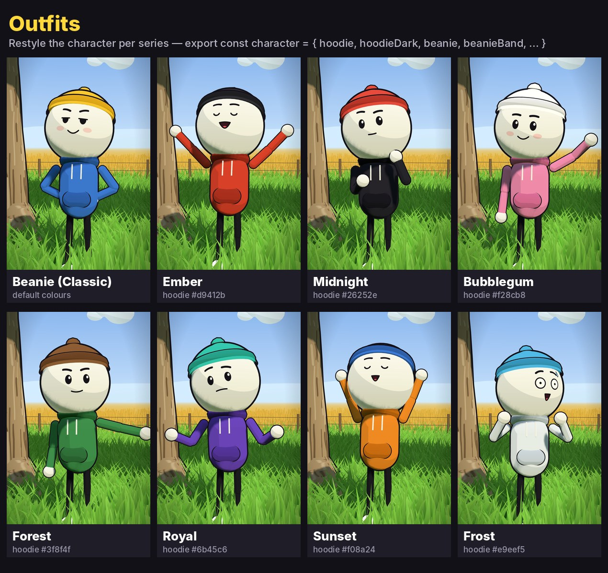

# cartoon-short-skill

A Claude skill that makes **Beanie Explains**: it turns a topic into a finished vertical (1080×1920) animated Short starring
**Beanie** (yellow beanie, blue hoodie). You get a toon-shaded 3D world,
Beanie with a fully expressive face, a narrator voice, procedural music and SFX, and word-by-word captions. It's all
rendered in code with **Three.js + headless Chromium + ffmpeg**: no Remotion and no AI video generation.

<p align="center"></p>

Example output: *"What if you stopped sleeping?"* (27 s). The full episode is in `cartoon-shorts/examples/stopped-sleeping/`.


Second example: *"What if you drank only coffee for a week?"* (41 s, `cartoon-shorts/examples/coffee-week/`). It shows off
props: a mug that follows the hand and a cup pyramid that builds as the narration says "twelve cups a day".

<p align="center"></p>


## What you can make it do

**19 built-in poses.** Blend between them with keyframes, or override any joint:


**Expressions.** The face is redrawn every frame from a few numbers, so it can morph smoothly between any of these:


**Outfits.** Beanie is the Classic look. Other presets are for side characters or other series, one line of colours each (presets in `docs/images/outfits.json`):



**Lighting per shot.** Switching the look between shots shows time passing:


These sheets are rendered by the engine itself: `python3 docs/gallery/build_gallery.py [sleep.mp4] [coffee.mp4]`
regenerates them, and the episode frames and GIF come from the optional MP4.

**Branding.** Add a `brand` block to `script.json` for a channel watermark and an end card, built from the
character's own face. Leave it out for an unbranded video.

<p align="center"></p>

## Install

Copy the `cartoon-shorts/` folder into a skills directory, e.g. `~/.claude/skills/cartoon-shorts/`, or into a
project's `.claude/skills/`. Then ask Claude for something like *"make a what-if short about drinking only coffee for a week"*.

Requirements on the machine that renders: Node 18+, `ffmpeg`, Python 3 with `numpy`, and Playwright with Chromium
(`npm i playwright && npx playwright install chromium`, or set `CHROMIUM_PATH`). The voice comes from Cartesia
(MCP connector) or the free offline Piper fallback.

## Manual use

```bash
S=cartoon-shorts
$S/scripts/new_project.sh ~/my-short           # engine + example episode
# write ~/my-short/script.json, put voice lines in ~/my-short/vo_raw/0.wav, 1.wav, ...
#   (or generate them offline: $S/scripts/tts_piper.sh ~/my-short)
$S/scripts/prep_voice.sh ~/my-short
(cd ~/my-short && python3 audio.py)            # timeline.json + audio.wav
# write ~/my-short/episode.js (see cartoon-shorts/references/episode-api.md)
$S/scripts/stills.sh ~/my-short 1 5 10 15      # preview contact sheet
$S/scripts/render_all.sh ~/my-short final.mp4  # full render
```

## Layout

```
cartoon-shorts/
  SKILL.md                     workflow Claude follows
  LICENSE                      MIT (copy shipped with the skill)
  engine/scene.html            Three.js renderer: set, character rig, procedural face, lighting, captions
  engine/render.mjs            headless Chromium frame capture -> ffmpeg
  engine/audio.py              word timings + procedural music/SFX mix
  scripts/                     new_project, tts_piper, prep_voice, stills, render_all
  references/episode-api.md    poses, face params, environments, cameras
  references/voices.md         Cartesia + Piper voice setup
  examples/stopped-sleeping/   complete example episode
  examples/coffee-week/        second example: props (mug, cup pyramid) + SFX cues
  references/*.jpg             pose / expression / outfit / lighting sheets (for Claude to look at)
docs/
  images/                      README gallery
  gallery/build_gallery.py     regenerates the gallery from the engine
```

## Credits

Created by **Sai Akash Neela** ([@SaiAkashNeela](https://github.com/SaiAkashNeela), [saiakashneela.com](https://www.saiakashneela.com)).
Beanie and the *Beanie Explains* name belong to the author. You're welcome to use the engine, and the Beanie design under
the MIT licence, but please brand your own channel with your own name and handle.

Contributions are welcome: open an issue or a pull request. New poses, props, sets and environments are especially welcome.
Run `python3 docs/gallery/build_gallery.py` after engine changes so the README sheets stay accurate.

## License

[MIT](LICENSE) © 2026 Sai Akash Neela.

### Third-party software and content

Nothing third-party is vendored in this repository; these are fetched or used at run time under their own licences:

| Component | Licence | How it's used |
|---|---|---|
| [three.js](https://github.com/mrdoob/three.js) | MIT | npm dependency of the render project |
| [Playwright](https://github.com/microsoft/playwright) / Chromium | Apache-2.0 / BSD-style | headless frame capture |
| [FFmpeg](https://ffmpeg.org) | LGPL/GPL (depends on your build) | encoding, run as an external program |
| [Inter](https://github.com/rsms/inter) font | SIL OFL 1.1 | system font for captions, not bundled |
| [Piper](https://github.com/rhasspy/piper) TTS | MIT | optional offline voice; each **voice model has its own licence**, so check the model card before publishing |
| [Cartesia](https://cartesia.ai) voices | Cartesia's terms | optional hosted voice; generated audio is subject to your Cartesia plan's terms |

All music and sound effects are synthesized from scratch by `engine/audio.py`, so the output contains no third-party audio.
You're responsible for the scripts and facts in videos you publish.

